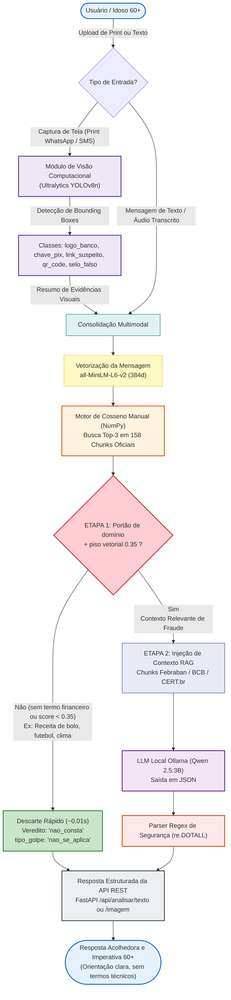

# Golpe Zero - CitizenTech 2026.2
Detecção de golpes de Pix e WhatsApp para pessoas com 60+ anos. FIAP Global Solution 2026.2, CitizenTech.

[](https://www.fiap.com.br)
[](https://www.python.org/)
[](https://fastapi.tiangolo.com)
[](https://pytorch.org/)
[](https://docs.ultralytics.com/)
[](https://ollama.ai)
[](https://creativecommons.org/licenses/by-nc-sa/4.0/)

---

## Ficha Técnica do MVP (base comum da equipe)

| Campo | Conteúdo |
| :--- | :--- |
| **Nome do produto** | Golpe Zero |
| **Cidadão e território** | Pessoas idosas (60+) do Estado de São Paulo, urbanas e rurais, usuárias de Pix e canais bancários digitais |
| **Problema, em uma frase** | Idosos perdem economias em golpes de Pix e WhatsApp por não conseguirem reconhecer sozinhos mensagens e capturas de tela fraudulentas. |
| **Proposta de valor** | Análise multimodal (visão computacional + RAG oficial + agente decisor) 100% local que devolve veredito e orientação imperativa e acolhedora, fundamentada em Febraban, Banco Central, CERT.br, Procon-SP e SSP-SP, sem enviar dados pessoais à nuvem. |
| **Arquitetura: componentes** | Módulo de visão YOLOv8n (5 classes) · Motor vetorial manual NumPy (all-MiniLM-L6-v2, 158 chunks) · Agente Decisor em 2 etapas (portão de domínio + piso 0.35) · LLM local Qwen2.5:3B via Ollama · API REST FastAPI · Estudo de especialização LoRA em Qwen2.5-0.5B-Instruct |
| **Fontes de dados** | Cartilhas e normas oficiais: Febraban, CERT.br/NIC.br, Banco Central do Brasil, Procon-SP, SSP-SP (158 chunks com fonte, URL e licença) · Dataset sintético de 150 capturas de tela anotadas em padrão YOLO (geração própria, sem dados de vítimas - LGPD) |
| **Modelos de IA utilizados** | YOLOv8n (fine-tuning supervisionado) · sentence-transformers/all-MiniLM-L6-v2 · Qwen2.5:3B Instruct (Ollama, 4-bit) · Qwen2.5-0.5B-Instruct + adapter LoRA (estudo de especialização, treino no Colab) |
| **URL do MVP e repositório** | Repositório: https://github.com/rcm2005/golpe-zero-gs · MVP: API FastAPI (`uvicorn src.api:app --port 8000`, Swagger em `/docs`); URL pública de produção sob responsabilidade da disciplina Secure DevOps Tools & Cloud Computing (componente Produção do time) |
| **Indicadores de impacto** | Acurácia de veredito nos 35 casos auditados (25 principais + 10 de estresse) · Recall@1 e Recall@3 da busca na base oficial · Latência de recusa fora de domínio (7 a 315 ms) · Fundamentação em fonte oficial · mAP@50 da detecção visual · % de respostas com citação de fonte oficial · Latência da inferência visual |
| **ODS conectados** | ODS 3, ODS 9, ODS 10 e ODS 11 (justificativas na seção 9) |

---

## 1. Visão Geral

O Golpe Zero ajuda pessoas com 60 anos ou mais a identificar golpes de Pix e WhatsApp no Estado de São Paulo. A pessoa envia o texto de uma mensagem ou o print da conversa e recebe um veredito (golpe, legítimo ou não consta) com a orientação do que fazer, citando a fonte oficial.

O sistema roda localmente: nenhuma mensagem ou imagem sai da máquina (LGPD). Para prints, um YOLOv8n detecta logotipos de banco, chaves Pix, links suspeitos, QR codes e selos falsos. O texto e o resumo visual passam por um agente de duas etapas: uma busca vetorial implementada em NumPy sobre 158 trechos de cartilhas oficiais (Febraban, Banco Central, CERT.br, Procon-SP e SSP-SP) e um LLM local (Qwen 2.5:3B via Ollama) que responde em JSON.

### Disciplinas atendidas

1. **Generative AI for Engineering** (Prof. Francisco Elânio Bezerra)
   * Relatório com os 7 tópicos exigidos ([relatorio/RELATORIO_GENAI.md](relatorio/RELATORIO_GENAI.md));
   * Auditoria dos 5 erros reais com causa-raiz técnica ([relatorio/07_auditoria_erros.md](relatorio/07_auditoria_erros.md));
   * Comparativo de especialização LoRA vs RAG simples ([relatorio/05_lora.md](relatorio/05_lora.md));
   * Caderno executável de Fine-Tuning com LoRA / PEFT ([notebooks/02_fine_tuning_lora.ipynb](notebooks/02_fine_tuning_lora.ipynb));
   * Benchmark comparativo das 3 arquiteturas com 35 casos de teste ([avaliacao/benchmark.py](avaliacao/benchmark.py)).
2. **Applied Computer Vision** (Profs. Arnaldo Viana e Paulo Rodrigues)
   * Detecção das 5 classes críticas: `logo_banco`, `chave_pix`, `link_suspeito`, `qr_code`, `selo_falso`;
   * Dataset anotado no padrão YOLO com gerador sintético ([vision/gerador_sintetico.py](vision/gerador_sintetico.py));
   * Script de treinamento e fine-tuning YOLOv8n ([vision/train_yolo.py](vision/train_yolo.py));
   * Script de inferência estruturada em JSON com bounding boxes ([vision/inference.py](vision/inference.py));
   * Detecção em tempo real em câmera ou vídeo, com FPS ([vision/tempo_real.py](vision/tempo_real.py));
   * Relatório formal em PDF dentro dos limites de palavras da rubrica ([vision/RELATORIO_VISAO.pdf](vision/RELATORIO_VISAO.pdf));
   * Vídeo de demonstração da solução funcionando ([vision/demo/video_demo_visao.mp4](vision/demo/video_demo_visao.mp4)).

---

## 2. Arquitetura Multimodal da Solução



---

## 3. Estrutura do Repositório

```bash
golpe-zero-gs/
├── README.md                           # Documentação central + Ficha Técnica do MVP
├── requirements.txt                    # Dependências do projeto
│
├── base/
│   └── chunks_oficiais.json            # 158 chunks curados (fonte, URL, licença)
│
├── avaliacao/
│   ├── benchmark.py                    # Benchmark das 3 arquiteturas (35 casos)
│   ├── benchmark_lora.py               # Comparativo LoRA vs RAG simples (base 0.5B)
│   ├── dataset_treino_lora.jsonl       # Dataset de treino LoRA (gerado no treino)
│   ├── treino_lora_log.json            # Loss por época do treino (gerado no treino)
│   ├── test_cases.json                 # 25 casos principais com gabarito e chunks_esperados
│   ├── test_cases_stress.json          # 10 casos adversariais de estresse com gabarito
│   ├── placar_benchmark.json           # Placar oficial completo (por caso e por split)
│   ├── placar_lora.json                # Placar do comparativo de especialização
│   └── recall_busca.json               # Recall@1, Recall@3 e calibração do limiar
│
├── notebooks/
│   ├── 01_pipeline_golpe_zero.ipynb    # Pipeline principal com saídas salvas
│   ├── 02_fine_tuning_lora.ipynb       # Fine-Tuning LoRA real (PEFT/HF) com saídas salvas
│   ├── treinar_lora.py                 # Script de treino LoRA reproduzível
│   ├── dataset_lora.py                 # Gerador do dataset LoRA (disjunto do gabarito)
│   ├── gerar_notebook_lora.py          # Executa o 02 com saídas e gera relatorio/05_lora.md
│   ├── colab_lora.ipynb                # Roda o treino LoRA no Google Colab (GPU)
│   ├── Caderno_de_fundamentos.ipynb    # Estudo de fundamentos de tensores
│   └── Mecanismo_atencao_armengue.ipynb# Estudo de auto-atenção
│
├── adapters/
│   └── golpe_zero_lora/                # Adapter LoRA treinado (gerado pelo Colab)
│
├── relatorio/
│   ├── RELATORIO_GENAI.md              # Relatório dos 7 tópicos da FIAP (GenAI)
│   ├── 05_lora.md                      # Especialização LoRA vs RAG simples
│   └── 07_auditoria_erros.md           # Auditoria aprofundada dos 5 erros reais
│
├── src/
│   ├── api.py                          # API REST FastAPI multimodal e texto
│   ├── llm_engine.py                   # Integração Ollama (Qwen 2.5:3B) e Agente Decisor
│   ├── vector_search.py                # Motor vetorial NumPy + Recall@1/@3 + limiar
│   └── ingestion.py                    # Pipeline de extração e chunking documental
│
└── vision/
    ├── dataset/                        # Dataset YOLO sintético (120 train / 30 val)
    ├── gerador_sintetico.py            # Motor de síntese de imagens e anotações
    ├── train_yolo.py                   # Script de treinamento YOLOv8n
    ├── inference.py                    # Inferência visual com resumo JSON
    ├── tempo_real.py                   # Detecção em tempo real (câmera ou vídeo)
    ├── weights/best.pt                 # Melhores pesos do modelo treinado
    ├── training_metrics.json           # Métricas oficiais do treino
    ├── runs/treino_golpe_zero/         # Curvas, matrizes e batches do treino real
    ├── RELATORIO_VISAO.md              # Relatório da disciplina de Visão (fonte do PDF)
    ├── RELATORIO_VISAO.pdf             # Entregável PDF na ordem da rubrica
    ├── build_pdf.py                    # Gerador reproduzível do PDF
    ├── build_video.py                  # Gerador reproduzível do vídeo de demonstração
    └── demo/video_demo_visao.mp4       # Vídeo de demonstração (≤ 3 min)
```

---

## 4. Guia de Instalação e Execução

### 4.1. Pré-requisitos
* Python 3.11 ou superior
* [Ollama](https://ollama.ai) instalado e em execução:
  ```bash
  ollama pull qwen2.5:3b
  ```

### 4.2. Configuração do Ambiente Virtual
```bash
# Clone o repositório
git clone https://github.com/rcm2005/golpe-zero-gs.git
cd golpe-zero-gs

# Crie e ative o ambiente virtual
python3 -m venv .venv
source .venv/bin/activate  # No Windows: .venv\Scripts\activate

# Instale as dependências
pip install -r requirements.txt
```

---

## 5. Como Executar os Entregáveis

### 5.1. Auditoria de Recuperação Vetorial (Recall@1, Recall@3 e limiar)
```bash
python -m src.vector_search
```
*Persiste `avaliacao/recall_busca.json` com os recalls medidos e a calibração do limiar.*

### 5.2. Benchmark Oficial das 3 Arquiteturas (35 casos)
Compara Zero-Shot, RAG Simples e Agente Decisor sobre 25 casos principais + 10 de estresse:
```bash
python -m avaliacao.benchmark
```
*Gera o placar completo em `avaliacao/placar_benchmark.json`.*

### 5.3. Comparativo de Especialização (LoRA vs RAG simples)
O treino exige GPU. No Google Colab, abra `notebooks/colab_lora.ipynb` com runtime T4 e execute as células: ele treina o adapter, roda o placar e gera `notebooks/02_fine_tuning_lora.ipynb` com saídas, `relatorio/05_lora.md`, `avaliacao/placar_lora.json` e `adapters/golpe_zero_lora/`. Localmente, com GPU ou 16 GB de RAM:
```bash
python -m notebooks.gerar_notebook_lora
```

### 5.4. Treinar o Modelo de Visão Computacional (YOLOv8n)
```bash
python vision/gerador_sintetico.py
python vision/train_yolo.py
```
*Salva os pesos em `vision/weights/best.pt` e as métricas em `vision/training_metrics.json`.*

### 5.5. Executar Inferência Visual Isolada
```bash
python vision/inference.py vision/dataset/images/val/golpe_val_0000.jpg
python -m vision.tempo_real --fonte 0 --mostrar          # câmera em tempo real
python -m vision.tempo_real --fonte gravacao.mp4         # vídeo, salva anotado
```
*Salva o print anotado em `vision/output_inferencia/resultado_deteccao.jpg` e imprime o JSON.*

### 5.6. Iniciar a API REST FastAPI
```bash
uvicorn src.api:app --reload --port 8000
```
*Acesse a documentação interativa Swagger em:* [http://localhost:8000/docs](http://localhost:8000/docs)

### 5.7. Reproduzir PDF e Vídeo da disciplina de Visão
```bash
python vision/build_pdf.py
python vision/build_video.py   # requer macOS com voz pt-BR (say) para narração
```

---

## 6. Documentação dos Endpoints da API REST

| Método | Endpoint | Descrição |
| :---: | :--- | :--- |
| `GET` | `/api/health` | Verifica status da API, carregamento do motor vetorial e Ollama local. |
| `POST` | `/api/analisar/texto` | Analisa mensagem suspeita de texto via Agente Decisor em 2 etapas. |
| `POST` | `/api/analisar/imagem` | Recebe arquivo de imagem (print), executa YOLOv8 e consolida veredito multimodal. |
| `GET` | `/api/buscar-chunks` | Realiza busca vetorial manual direta na base de 158 chunks oficiais. |

### Exemplo de Requisição (`POST /api/analisar/texto`):
```json
{
  "texto": "Oi mãe, salvei esse número novo. Preciso pagar o conserto do carro urgente de R$ 1.450 via Pix na chave 11988223344.",
  "arquitetura": "agente",
  "threshold": 0.35
}
```

### Exemplo de Resposta Estruturada:
```json
{
  "veredito": "golpe",
  "tipo_golpe": "falso_whatsapp",
  "sinais_encontrados": [
    "Troca de número de familiar",
    "Urgência financeira de terceiros",
    "Chave Pix para conta desconhecida"
  ],
  "fonte_oficial": "Febraban Antifraudes - Golpe do Whatsapp",
  "proximo_passo": "NÃO faça o Pix. DESLIGUE ou pare de responder e ligue imediatamente para o número antigo do seu filho para confirmar.",
  "metadados": {
    "latencia_seg": 4.12,
    "modelo": "qwen2.5:3b",
    "score_maximo": 0.5966,
    "etapa_decisao": "Etapa 2 (LLM RAG Fundamentado)"
  }
}
```

---

## 7. Placar Comparativo do Benchmark Oficial

Tabela gerada a partir de `avaliacao/placar_benchmark.json` (35 casos: 25 principais + 10 de estresse). Valores por caso e por split no JSON e em [relatorio/RELATORIO_GENAI.md](relatorio/RELATORIO_GENAI.md).

| Arquitetura | Acurácia Veredito | Taxa Alucinação | Conformidade JSON | Latência Média | Latência Fora de Domínio |
| :--- | :---: | :---: | :---: | :---: | :---: |
| **Zero-Shot (Sem Contexto)** | 85,7% | 14,3% | 100% | 6,47 s | 6,36 s |
| **Pipeline RAG Simples** | 80,0% | 17,1% | 100% | 8,21 s | 8,22 s |
| **Agente Decisor (2 Etapas)** | 80,0% | 17,1% | 100% | 7,51 s | 0,007 a 0,315 s nos 5 casos fora de domínio |

Fundamentação em fonte oficial nos 19 golpes: zero-shot 68,4%, RAG simples 100%, agente 89,5%. O zero-shot ficou 2 casos à frente em veredito; o ganho do RAG é a citação verificável. Interpretação completa e limites em [relatorio/RELATORIO_GENAI.md](relatorio/RELATORIO_GENAI.md).

---

## 8. Equipe e Informações Acadêmicas

* **Instituição:** FIAP - Global Solution 2026.2
* **Tema Global:** CitizenTech - Tecnologias para a Cidadania e Proteção Social
* **Curso:** Engenharia de Software - 4º ano (4ES)
* **Integrantes:**
  * Levy Nascimento Junior - RM: 98655
  * Rafael Autieri dos Anjos - RM: 550885
  * Allan Von Ivanov - RM: 98705
  * Luiza Cristina Silva - RM: 99367
  * Rafael Carvalho Mattos - RM: 99874

---

## 9. ODS conectados

* **ODS 3 (Saúde e bem-estar, meta 3.4):** golpes financeiros causam ansiedade e perda de autonomia em idosos. Prevenir a fraude e orientar sem culpar a vítima protege a saúde mental.
* **ODS 9 (Indústria, inovação e infraestrutura, metas 9.5 e 9.c):** IA que roda localmente, sem nuvem, em equipamentos modestos e com pouca conectividade.
* **ODS 10 (Redução das desigualdades, metas 10.2 e 10.3):** reduz a vulnerabilidade digital dos idosos no uso de serviços financeiros.
* **ODS 11 (Cidades e comunidades sustentáveis, meta 11.7):** torna mais seguro o ambiente digital da cidade, com um serviço gratuito de proteção contra fraudes.

---

## 10. Privacidade, segurança e IA responsável

* **LGPD:** a inferência é local (Ollama e YOLOv8n). O dataset de visão é sintético, sem imagens de vítimas.
* **Explicabilidade:** cada resposta traz score, trechos usados e fonte com licença. Fora de domínio, o sistema responde `nao_consta`.
* **Pessoa no circuito:** toda resposta de golpe orienta confirmar com familiar ou banco por canal oficial antes de agir.
* **Erros documentados:** os 5 erros reais, com causa e correção, estão em [relatorio/07_auditoria_erros.md](relatorio/07_auditoria_erros.md).
* **Sem segredos no repositório:** nenhuma chave de API, senha ou dado pessoal real versionado.
