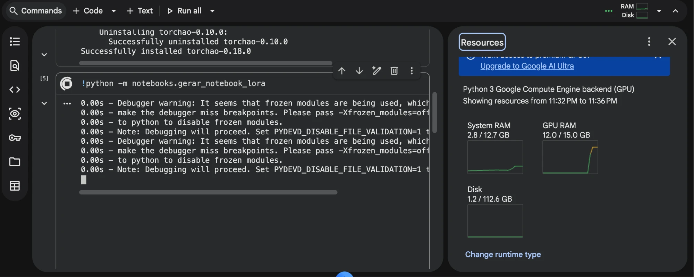
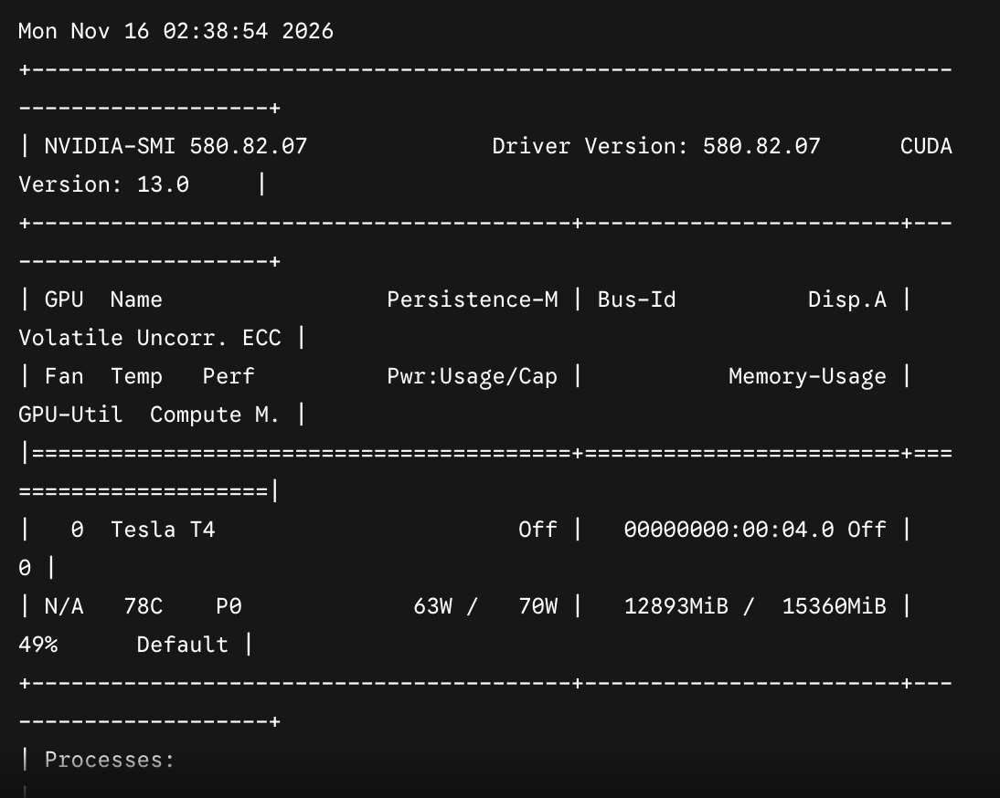
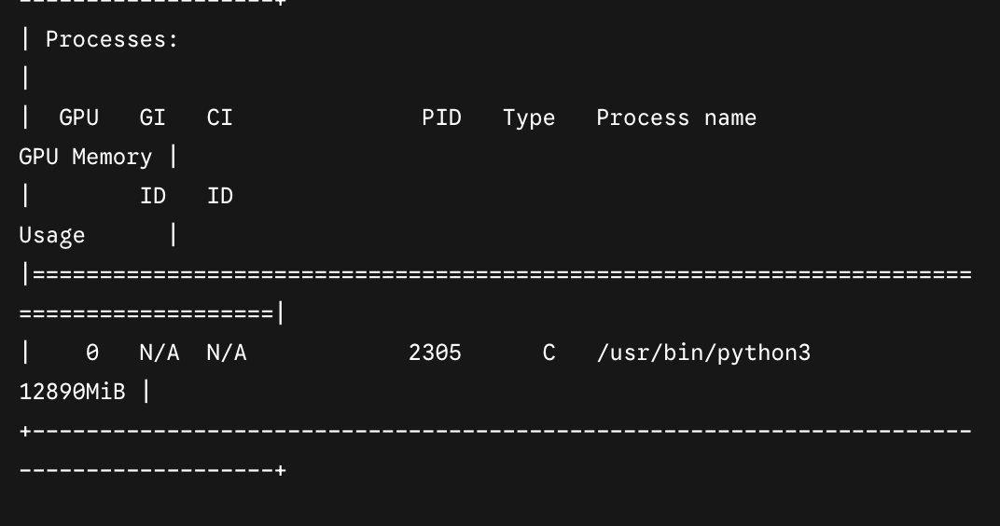

# Especialização: LoRA vs RAG simples (base Qwen2.5-0.5B-Instruct)

## Protocolo
- Modelo base: `Qwen/Qwen2.5-0.5B-Instruct`. Mesma base nas três configurações; o adapter é desligado nas duas primeiras.
- Treino LoRA: 240 exemplos sintéticos (`avaliacao/dataset_treino_lora.jsonl`), r=8, alpha=16, módulos `q_proj` e `v_proj`, 3 épocas, lr 0.0002, 540,672 parâmetros treináveis de 494,573,440 (0.11%).
- Avaliação held-out: os 35 casos de `avaliacao/test_cases.json` e `avaliacao/test_cases_stress.json`. Nenhuma mensagem do gabarito foi usada no treino (verificado em código).
- Métricas idênticas às do benchmark principal. JSON válido exige as 5 chaves do schema.

## Resultado
| Configuração | Acurácia | Alucinação | JSON válido | Fundamentação | Acurácia estresse | Latência média |
| :--- | :---: | :---: | :---: | :---: | :---: | :---: |
| Base 0.5B zero-shot | 25.71% | 28.57% | 100.0% | 5.26% | 20.0% | 3.146 s |
| Base 0.5B + RAG simples | 54.29% | 45.71% | 100.0% | 5.26% | 40.0% | 2.984 s |
| Base 0.5B + LoRA | 71.43% | 14.29% | 97.14% | 84.21% | 60.0% | 3.57 s |

## Evidência da execução
Treino e avaliação rodaram no Google Colab com GPU Tesla T4 (116 s de treino, loss média de 1,54 na época 1 para 0,62 na época 3, histórico em `avaliacao/treino_lora_log.json`).

## Interpretação
- **LoRA superou o RAG simples na mesma base de 0.5B:** 71,4% contra 54,3% de acurácia (25 de 35 casos contra 19), e alucinação de 14,3% contra 45,7%. O zero-shot da base ficou em 25,7%. No split principal a ordem é a mesma: 76%, 60% e 28%.
- **Onde o LoRA ganhou:** os avisos bancários legítimos. `tc_016`, `tc_017`, `tc_020` e `tc_027` ficaram corretos com LoRA e errados com RAG. São os mesmos casos que o modelo de 3B erra no benchmark principal (erro 4 da auditoria). O RAG com 0.5B piora esses casos porque os trechos de golpes empurram o modelo para `golpe`.
- **Onde o LoRA ainda erra (10 casos):** cinco golpes lidos como `legitimo` ou `nao_consta` (`tc_001`, `tc_005`, `tc_009`, `tc_012` e `tc_034`), e os fora de domínio `tc_021`, `tc_022`, `tc_029`, `tc_030` e `tc_031` lidos como `golpe`. Os três adversariais (`tc_029` a `tc_031`) continuam errados, como no modelo de 3B. Um caso (`tc_021`) gerou JSON inválido.
- **Fundamentação (84,2% contra 5,3%) exige cautela.** No dataset de treino, a fonte de cada tipo de golpe foi fixada por nós (por exemplo, falso motoboy cita Febraban). O LoRA aprendeu esse mapeamento de rótulo; ele não está citando o trecho que leu. O RAG de 0.5B recebe o texto oficial, mas quase não o cita na resposta (1 de 19). Em produção, com o 3B, o RAG cita a fonte certa em 19 de 19 (relatório principal).
- **Latência:** o LoRA ficou em 3,57 s contra 2,98 s do RAG simples, sem diferença relevante. O adapter só soma 540 mil parâmetros e não aumenta o prompt.
- **Comparação com o modelo de produção:** o 0.5B com LoRA (71,4%) fica abaixo do Qwen2.5:3B com prompt de critérios (80 a 85,7%). A especialização ajuda muito o modelo pequeno, mas não o torna melhor que o maior. Uma combinação possível é o LoRA no 3B mais o portão de domínio, que já recusa `tc_021` a `tc_025` antes do modelo; isso não foi testado.
- **Limites:** 35 casos, uma execução, dataset de treino sintético escrito por nós e modelo de 0.5B. Diferenças de 1 ou 2 casos não são conclusivas. O LoRA não atualiza conhecimento; ele ajusta formato e critério de decisão.
