# FIAP Global Solution 2026.2 • CitizenTech
# Golpe Zero - Relatório Técnico de Engenharia de IA Generativa
**Disciplina:** Generative AI for Engineering · **Docente:** Prof. Francisco Elânio Bezerra · **Data:** Novembro de 2026

---

## 1. Integrantes

| Nome completo | RM |
| :--- | :---: |
| Levy Nascimento Junior | 98655 |
| Rafael Autieri dos Anjos | 550885 |
| Allan Von Ivanov | 98705 |
| Luiza Cristina Silva | 99367 |
| Rafael Carvalho Mattos | 99874 |

---

## 2. Ficha Técnica: o que a IA resolve

**Problema:** idosos (60+) do Estado de São Paulo perdem dinheiro em golpes de Pix e WhatsApp porque não conseguem distinguir sozinhos uma mensagem fraudulenta de um aviso legítimo.

**Tarefa da IA:** receber o texto de uma mensagem (ou o resumo visual de um print) e devolver um JSON com `veredito` (`golpe`, `legitimo` ou `nao_consta`), `tipo_golpe`, `sinais_encontrados`, `fonte_oficial` e `proximo_passo` imperativo e acolhedor, fundamentado em Febraban, Banco Central, CERT.br, Procon-SP e SSP-SP. Mensagens sem relação com finanças devem receber `nao_consta`.

**Tema do enunciado:** segurança. Execução 100% local, sem enviar dados pessoais à nuvem (LGPD).

| Componente | Especificação | Justificativa |
| :--- | :--- | :--- |
| Embeddings | `sentence-transformers/all-MiniLM-L6-v2` (384 dimensões) | Leve e roda em CPU. Busca top-3 em ~54 ms. Treinado sobretudo em inglês, o que limita o recall em português (seção 5.2). |
| Recuperação (RAG) | Cosseno manual em NumPy sobre 158 chunks | Sem LangChain nem banco vetorial: score, limiar e recall ficam auditáveis. |
| LLM de produção | Qwen2.5:3B Instruct via Ollama (4-bit) | Roda local e segue schema JSON (`format: json`). |
| Especialização | LoRA em Qwen2.5-0.5B-Instruct (r=8, alpha=16, `q_proj` e `v_proj`) | Comparada ao RAG simples na mesma base (seção 5.3). |
| Agente decisor | Etapa 1: portão lexical de domínio + piso vetorial 0.35. Etapa 2: LLM com contexto RAG | Evita chamar a LLM em mensagens sem vocabulário financeiro. |
| API | FastAPI + Pydantic: `/api/analisar/texto`, `/api/analisar/imagem`, `/api/health`, `/api/buscar-chunks` | Contrato JSON único para texto e imagem (YOLOv8n). |

---

## 3. Diagrama do Pipeline de IA

O fluxo do sistema opera sob o paradigma do **Agente Decisor em Duas Etapas**, que filtra consultas claramente fora de domínio antes de gastar a LLM. Consultas adversariais que usam vocabulário financeiro passam pela Etapa 1 e dependem da LLM (ver seção 6).

```mermaid
flowchart TD
    A(["Entrada do Usuário<br/>(Texto, Print WhatsApp ou SMS)"]):::user --> B{"Tipo de Entrada?"}
    
    %% Trilha Visual
    B -- "Print / Imagem" --> C["Módulo de Visão YOLOv8n<br/>(Detecção de Logo, Pix, Link, QR, Selo)"]:::vision
    C --> D["Extração de Evidências Visuais e Risco"]:::vision
    D --> E["Concatenação Multimodal<br/>(Texto Extra + Resumo Visual)"]:::process
    
    %% Trilha Texto Direto
    B -- "Mensagem de Texto" --> E
    
    %% Motor de Recuperação
    E --> F["Vetorização da Mensagem<br/>all-MiniLM-L6-v2 (384d)"]:::embed
    F --> G["Cálculo Manual de Similaridade de Cosseno<br/>NumPy puro vs. 158 Chunks Oficiais"]:::math
    G --> H["Recuperação dos Top-3 Chunks<br/>Score Máximo (S_max)"]:::math
    
    %% ETAPA 1 - Limiar
    H --> I{"ETAPA 1: Portão de domínio<br/>+ piso vetorial S_max >= 0.35 ?"}:::decision
    
    I -- "Não (sem termo financeiro ou S_max < 0.35)<br/>Ex: Bolo de Fubá, Clima" --> J["Recusa Imediata (~0.01s)<br/>Veredito: 'nao_consta'<br/>tipo_golpe: 'nao_se_aplica'"]:::fastpath
    
    %% ETAPA 2 - LLM Fundamentada
    I -- "Sim<br/>Contexto Financeiro Relevante" --> K["ETAPA 2: Injeção de Contexto RAG<br/>Chunks Oficiais: Febraban / BCB / CERT.br"]:::rag
    K --> L["Inferência Local Ollama<br/>Qwen 2.5:3B (saída em JSON)"]:::llm
    L --> M["Validador e Parser Regex JSON<br/>(json.loads + extração por regex)"]:::guardrail
    
    %% Consolidação e Resposta
    J --> N["Contrato AnaliseResponse (JSON)"]:::output
    M --> N
    N --> O(["Orientação Acolhedora e Imperativa 60+<br/>(Veredito, Sinais, Norma Oficial, Próximo Passo)"]):::user

    classDef user fill:#E3F2FD,stroke:#1565C0,stroke-width:2px;
    classDef vision fill:#EDE7F6,stroke:#512DA8,stroke-width:2px;
    classDef process fill:#E0F2F1,stroke:#00796B,stroke-width:1px;
    classDef embed fill:#FFF9C4,stroke:#FBC02D,stroke-width:1px;
    classDef math fill:#FFF3E0,stroke:#E65100,stroke-width:2px;
    classDef decision fill:#FFCDD2,stroke:#C62828,stroke-width:2px;
    classDef fastpath fill:#C8E6C9,stroke:#2E7D32,stroke-width:2px;
    classDef rag fill:#E8EAF6,stroke:#283593,stroke-width:1px;
    classDef llm fill:#F3E5F5,stroke:#6A1B9A,stroke-width:2px;
    classDef guardrail fill:#FBE9E7,stroke:#D84315,stroke-width:2px;
    classDef output fill:#ECEFF1,stroke:#37474F,stroke-width:2px;
```

---

## 4. Base de Conhecimento: fonte, formato, licença e número de trechos

A base vetorial do Golpe Zero é composta por **158 chunks curados** extraídos de fontes primárias e governamentais brasileiras pelo pipeline de ingestão (`src/ingestion.py`: extração HTML/PDF → limpeza → chunking de 280–550 caracteres com sobreposição de 40 → JSON com metadados `id`, `fonte`, `url`, `licenca`, `tipo_golpe`). Todas as informações estão em conformidade com as legislações de utilidade pública e livre distribuição educacional:

| Instituição Fonte | Escopo Temático Principal | Formato (origem → artefato) | Qtd. Chunks | Licença / Base Legal |
| :--- | :--- | :--- | :---: | :--- |
| **Febraban** (Federação Brasileira de Bancos) | Cartilhas Antifraude: Falsa Central Telefônica, Falso Motoboy, Golpe do WhatsApp/Novo Número, Mão Fantasma (Acesso Remoto), Golpe do Pix Errado, Troca de Cartão, Maquininha Quebrada e Falso Advogado. | Cartilha web (páginas HTML "Como é / Como evitar" do Portal Antifraudes) → chunk JSON | 70 | Domínio Público / Campanha Institucional Aberta Febraban Antifraudes |
| **CERT.br / NIC.br** (CGI.br) | Cartilha de Segurança para a Internet: Phishing, Engenharia Social, Engenharia Reversa de Golpes, Fraudes de Comércio Eletrônico e Passos de Remediação. | Cartilha web/PDF (fascículos "Golpes" extraídos via `pypdf`) → chunk JSON | 65 | Licença Aberta Creative Commons Atribuição-NãoComercial-CompartilhaIgual (CC BY-NC-SA 4.0) |
| **Banco Central do Brasil (BCB)** | Resoluções BCB nº 103 e nº 147: Funcionamento do Mecanismo Especial de Devolução (MED), Bloqueio Cautelar do Pix, Limites Noturnos e Normas de Contestação. | Notícia/norma web (páginas e textos normativos MED/Pix) → chunk JSON | 14 | Lei de Acesso à Informação (Lei 12.527/2011) e Atos Normativos Federais Públicos |
| **Procon-SP** | Cartilhas do Consumidor Idoso: Súmula 479 do STJ (Responsabilidade Objetiva dos Bancos), Art. 49 do CDC, Contestação de Compras Não Reconhecidas e Alertas de Lojas Falsas. | Cartilha/alerta web (páginas institucionais CDC e "Evite esses sites") → chunk JSON | 5 | Informação Governamental de Utilidade Pública (Governo de SP) |
| **SSP-SP** (Polícia Civil de SP) | Cartilha da Delegacia Eletrônica: Registro de Boletim de Ocorrência Digital, Artigo 171 § 2º-A do CP (Fraude Eletrônica) e Preservação da Cadeia de Custódia Digital. | Cartilha web (Delegacia Eletrônica / tipificação penal) → chunk JSON | 4 | Informação Pública de Segurança Pública do Estado de São Paulo |
| **TOTAL CONSOLIDADO** | **158 Chunks Estruturados com Metadados e IDs Únicos** | **100% JSON auditável** (`base/chunks_oficiais.json`) | **158** | **100% Auditável, Legal e em Domínio Público/Educacional** |

*Contagens verificadas por execução real sobre `base/chunks_oficiais.json` (70 + 65 + 14 + 5 + 4 = 158).*

---

## 5. Performance do Modelo nas Configurações Testadas

### 5.1 Casos de teste e placar das 3 configurações

Gabarito: `avaliacao/test_cases.json` (25 casos: 15 golpes, 5 legítimos, 5 fora de domínio) e `avaliacao/test_cases_stress.json` (10 casos adversariais: 4 golpes, 3 legítimos, 3 fora de domínio), total de 35. Casos fora de domínio esperam `nao_consta`. Placar completo por caso em `avaliacao/placar_benchmark.json`, reproduzido por `python -m avaliacao.benchmark`.

Definições: **alucinação** = caso legítimo ou fora de domínio classificado como `golpe`. **Fundamentação** = nos 19 golpes, a fonte citada em `fonte_oficial` casa com a fonte de algum chunk do gabarito.

| Métrica (35 casos) | Zero-Shot (sem contexto) | RAG Simples | Agente Decisor (2 etapas) |
| :--- | :---: | :---: | :---: |
| Acurácia de veredito | **85,7%** (30/35) | 80,0% (28/35) | 80,0% (28/35) |
| Acurácia, split principal (25) | 96,0% | 88,0% | 88,0% |
| Acurácia, split estresse (10) | 60,0% | 60,0% | 60,0% |
| Alucinação | **14,3%** | 17,1% | 17,1% |
| JSON válido | 100% | 100% | 100% |
| Fundamentação em fonte oficial | 68,4% (13/19) | **100%** (19/19) | 89,5% (17/19) |
| Latência média | **6,47 s** | 8,21 s | 7,51 s |
| Latência nos 5 casos claramente fora de domínio | 6,36 s | 8,22 s | **0,007 a 0,315 s** |

### 5.2 Interpretação dos resultados

- **O zero-shot não perdeu em veredito.** Com o prompt de critérios (seção 6, erro 1), o 3B já separa bem golpe, legítimo e fora de domínio. A diferença para RAG e agente é de 2 casos em 35 (`tc_016` e `tc_020`, avisos legítimos que o contexto de golpes empurrou para `golpe` e `nao_consta`). Não dá para afirmar que o RAG "acerta mais" em veredito neste conjunto.
- **O ganho do RAG é a fundamentação.** Sem contexto, o modelo cita a fonte certa em 13 de 19 golpes e erra ou inventa em `tc_004`, `tc_005`, `tc_010`, `tc_011`, `tc_013` e `tc_032`. Com contexto, cita a fonte oficial correta em 19 de 19. Para um produto que orienta idosos, citação verificável é o que permite conferir a resposta.
- **O agente iguala o RAG em veredito e reduz custo onde pode.** Nos 5 casos claramente fora de domínio (`tc_021` a `tc_025`) a Etapa 1 recusa em 7 a 315 ms sem chamar a LLM. Os demais casos de estresse passam pela LLM.
- **Os mesmos 3 casos adversariais falham nas três configurações:** `tc_029`, `tc_030` e `tc_031` (urgência, prazo e "conta" em contexto de bolo, pelada e jogo) são classificados como `golpe`. Eles têm vocabulário financeiro, então passam pela Etapa 1 e o 3B não os recusa. Todas as configurações também erram `tc_017` e `tc_027` (código de verificação legítimo lido como golpe).
- **Limites da medição:** 35 casos e uma execução por configuração; a LLM tem variação entre execuções (o agente teve 17/19 de fundamentação contra 19/19 do RAG nos mesmos chunks). O prompt de critérios foi ajustado depois de ver os erros desses mesmos 35 casos, portanto os números são otimistas para dados novos.

### 5.3 Recuperação vetorial: recall@1, recall@3 e limiar

Medido por `python -m src.vector_search` sobre os 15 golpes do split principal, com `chunks_esperados` como gabarito (`avaliacao/recall_busca.json`).

| Métrica | Valor |
| :--- | :---: |
| **Recall@1** | **33,33%** (5/15) |
| **Recall@3** | **46,67%** (7/15) |
| Score de golpes (média / mín / máx) | 0,5501 / 0,3958 / 0,6762 |
| Score de legítimos | 0,6335 / 0,5735 / 0,7443 |
| Score fora de domínio | 0,5282 / 0,4988 / 0,5646 |

**Limiar justificado.** O ponto médio entre o maior score fora de domínio (0,5646) e o menor de golpe (0,3958) é 0,48, mas as faixas se sobrepõem: nenhum corte separa as classes. Com 0,48, três golpes reais (`tc_009`, `tc_013`, `tc_014`) eram recusados como `nao_consta`. Como deixar passar um golpe custa mais ao idoso do que gastar uma chamada da LLM, adotamos um **piso de 0,35** (menor score de golpe menos 0,05), que não descarta nenhum golpe do gabarito. A recusa de mensagens fora de domínio passou a ser feita pelo **portão lexical** da Etapa 1 (`GATILHOS_DOMINIO` em `src/llm_engine.py`), que não barra nenhum dos 19 golpes. O recall baixo vem do embedding treinado sobretudo em inglês e da ausência na base de alguns tipos (Correios, DETRAN, loja falsa); trocar por um embedding multilíngue é o próximo passo.

### 5.4 Especialização paramétrica: LoRA vs RAG simples

Um adapter LoRA (r=8, alpha=16, `q_proj` e `v_proj`; 540 mil parâmetros treináveis, 0,11% do modelo) foi treinado sobre o Qwen2.5-0.5B-Instruct com 240 exemplos sintéticos disjuntos do gabarito (`notebooks/dataset_lora.py`, com verificação automática de vazamento). O treino rodou no Google Colab com GPU T4 em 116 s (loss de 1,54 para 0,62). A avaliação é nos mesmos 35 casos, comparando LoRA, RAG simples e zero-shot **na mesma base de 0.5B**.

| Base 0.5B | Acurácia | Alucinação | JSON válido | Fundamentação |
| :--- | :---: | :---: | :---: | :---: |
| Zero-shot | 25,7% | 28,6% | 100% | 5,3% |
| RAG simples | 54,3% | 45,7% | 100% | 5,3% |
| **LoRA** | **71,4%** | **14,3%** | 97,1% | 84,2% |

O LoRA supera o RAG simples em 17 pontos de acurácia e corrige os avisos bancários legítimos que o RAG classifica como golpe (`tc_016`, `tc_017`, `tc_020`, `tc_027`). Ele continua errando os casos adversariais `tc_029` a `tc_031`. A fundamentação de 84,2% reflete o mapeamento de fonte fixado no dataset de treino, não leitura de trecho, e deve ser lida com essa ressalva. O 0.5B com LoRA (71,4%) fica abaixo do 3B de produção (80 a 85,7%). Protocolo completo, evidências do Colab e interpretação em [05_lora.md](05_lora.md); resultados por caso em `avaliacao/placar_lora.json`; execução com saídas em [02_fine_tuning_lora.ipynb](../notebooks/02_fine_tuning_lora.ipynb).

---

## 6. Os 5 Erros Reais, Causa e Correção

Detalhamento com trechos de código em [07_auditoria_erros.md](07_auditoria_erros.md).

| # | Erro observado | Causa | Correção |
| :-: | :--- | :--- | :--- |
| 1 | Primeira execução do placar: zero-shot e RAG acertaram 68,6% e classificaram como `golpe` 11 dos 16 casos legítimos ou fora de domínio (alucinação de 31,4%). | O prompt mandava "proteger o idoso" sem critério de decisão; o 3B tratou qualquer aviso como golpe. | Critérios explícitos de `golpe`, `legitimo` e `nao_consta` no prompt de sistema. Zero-shot foi a 85,7% e a alucinação caiu a 14,3%. |
| 2 | Com limiar 0,48 o agente recusou 3 golpes reais (`tc_009` Correios, `tc_013` DETRAN, `tc_014` loja falsa) e a acurácia caiu para 60%. | Esses golpes não têm chunk próprio na base e o embedding em inglês dá score baixo (mín 0,3958). | Piso 0,35 mais portão lexical de domínio. O agente não recusa mais nenhum golpe. |
| 3 | Ao enquadrar o contexto como "material de referência que NÃO indica golpe", o RAG errou 21 de 35 casos, quase todos respondendo `nao_consta` (acurácia 40%). | A instrução negativa levou o 3B a ignorar o conteúdo da mensagem. | Instrução de comparação: pede golpe se a mensagem seguir o molde de golpe descrito, `legitimo` se for aviso informativo, `nao_consta` se não for financeiro. Acurácia do RAG foi a 80%. |
| 4 | `tc_017` e `tc_027` (código de verificação do Caixa Tem, legítimo) saem como `golpe`; `tc_016` e `tc_020` mudam de veredito com RAG. | O 3B associa "código" e "segurança" a fraude e o contexto de golpes reforça o viés. | Não corrigido nesta versão. Proposta: exemplos de avisos legítimos no treino e chunks da base com o formato de mensagens legítimas dos bancos. Na base de 0.5B, o LoRA já corrigiu esses 4 casos (seção 5.4); falta treinar sobre o 3B. |
| 5 | `tc_029`, `tc_030` e `tc_031` (bolo, pelada, jogo com "urgente", "prazo", "conta") viram `golpe` nas três configurações. | Passam pelo portão lexical por usarem palavras financeiras e o 3B não os recusa. | Não corrigido. Proposta: exemplos adversariais no treino (o LoRA de 0.5B ainda errou os três) e pessoa no circuito: o `proximo_passo` de um `golpe` recomenda confirmar com familiar ou banco antes de agir. |

---

## 7. Conclusão Técnica e Links

**Conclusão.** O pipeline entrega JSON válido em 100% dos 35 casos, cita fonte oficial verificável (100% com RAG contra 68% sem contexto) e recusa em milissegundos mensagens claramente fora de domínio. Em veredito, o zero-shot com prompt de critérios (85,7%) ficou 2 casos à frente de RAG e agente (80%), então a vantagem do contexto aqui é rastreabilidade, não acurácia. Os pontos fracos medidos são o viés do 3B contra avisos bancários legítimos e os casos adversariais com vocabulário financeiro, que o LoRA corrigiu em parte no modelo de 0.5B (avisos legítimos) mas não nos adversariais. O recall@1 de 33% mostra que o embedding em inglês é o gargalo de recuperação. O sistema apoia a decisão do idoso e não a substitui: toda orientação de golpe pede confirmação por canal oficial.

**Links.**
* Repositório: [github.com/rcm2005/golpe-zero-gs](https://github.com/rcm2005/golpe-zero-gs)
* Vídeo de demonstração: [vision/demo/video_demo_visao.mp4](../vision/demo/video_demo_visao.mp4)
* Notebooks: [01_pipeline_golpe_zero.ipynb](../notebooks/01_pipeline_golpe_zero.ipynb) · [02_fine_tuning_lora.ipynb](../notebooks/02_fine_tuning_lora.ipynb)
* Erros: [07_auditoria_erros.md](07_auditoria_erros.md) · LoRA: [05_lora.md](05_lora.md)
* Base e testes: [chunks_oficiais.json](../base/chunks_oficiais.json) · [test_cases.json](../avaliacao/test_cases.json) · [test_cases_stress.json](../avaliacao/test_cases_stress.json)
* Placares: [placar_benchmark.json](../avaliacao/placar_benchmark.json) · [placar_lora.json](../avaliacao/placar_lora.json) · [recall_busca.json](../avaliacao/recall_busca.json)
* Relatório de Visão: [RELATORIO_VISAO.md](../vision/RELATORIO_VISAO.md)
