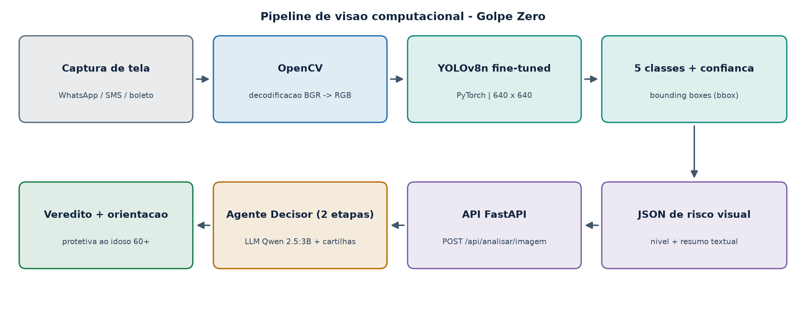
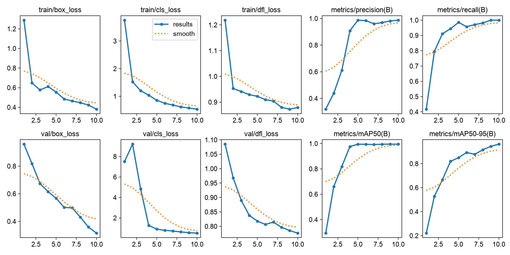
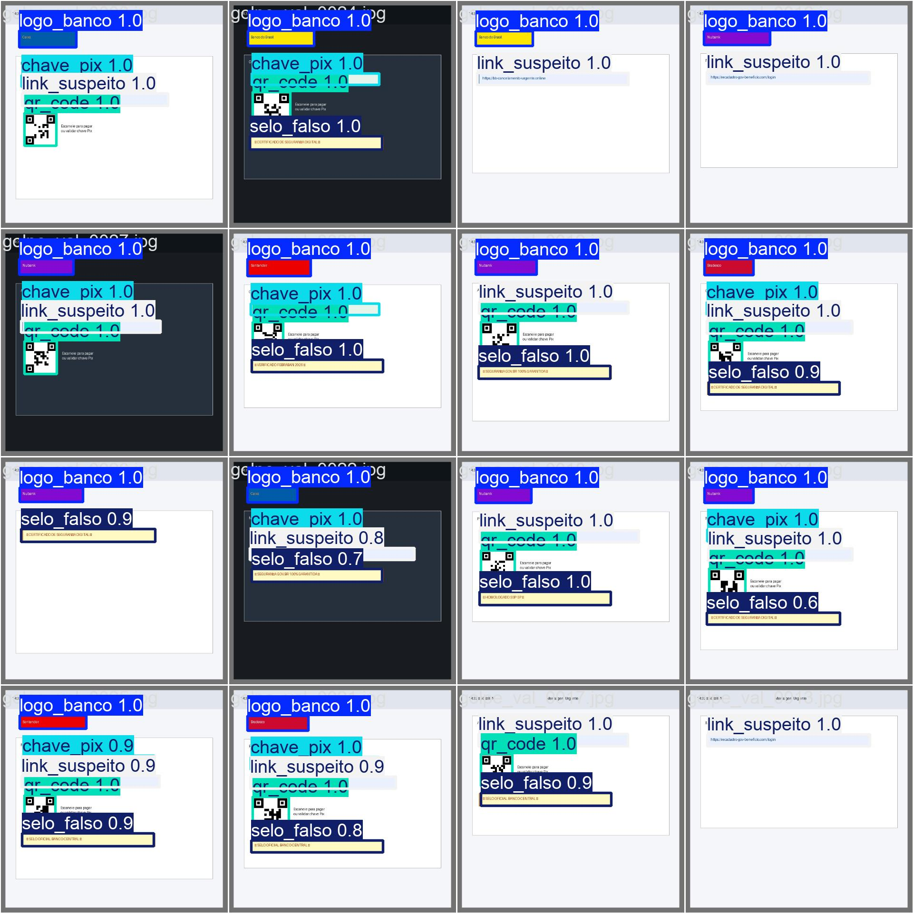
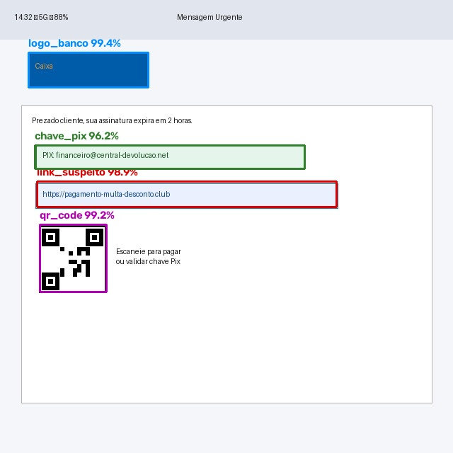
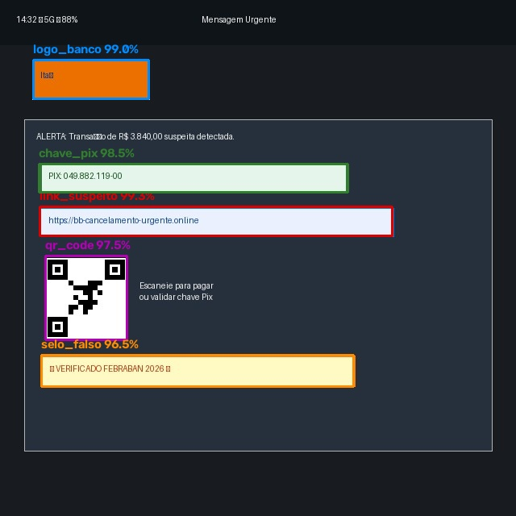

# Golpe Zero - Relatório Técnico de Visão Computacional Aplicada

**FIAP Global Solution 2026.2, CitizenTech**
**Disciplina:** Applied Computer Vision
**Docentes:** Prof. Arnaldo Viana e Prof. Paulo Rodrigues
**Projeto:** Golpe Zero - Sistema Multimodal de Proteção de Idosos 60+ contra Fraudes Digitais em SP
**Modelo:** YOLOv8n (fine-tuning para detecção de elementos gráficos em golpes financeiros)
**Data:** Novembro de 2026

---

## 1. Integrantes

- Levy Nascimento Junior - RM98655
- Rafael Autieri dos Anjos - RM550885
- Allan Von Ivanov - RM98705
- Luiza Cristina Silva - RM99367
- Rafael Carvalho Mattos - RM99874

---

## 2. Resumo

O estelionato digital contra pessoas idosas explora a engenharia social em aplicativos de mensagens e no ecossistema de pagamentos instantâneos (Pix). Criminosos imitam a identidade visual de bancos e órgãos oficiais para induzir transferências indevidas. Este trabalho apresenta o módulo de visão computacional do projeto Golpe Zero (FIAP Global Solution 2026.2, CitizenTech), que inspeciona automaticamente capturas de tela de WhatsApp, SMS, boletos e comprovantes bancários enviados por pessoas com 60 anos ou mais.

Foi realizado o fine-tuning do YOLOv8n (Ultralytics/PyTorch) para detectar cinco classes de elementos gráficos fraudulentos: `logo_banco`, `chave_pix`, `link_suspeito`, `qr_code` e `selo_falso`. O dataset é 100% sintético - 120 imagens de treino e 30 de validação geradas proceduralmente por `vision/gerador_sintetico.py` -, decisão motivada pela LGPD: prints reais de vítimas conteriam dados pessoais sensíveis (chaves Pix, CPFs, telefones), inviabilizando seu uso sem consentimento. A síntese emula interfaces claras e escuras de smartphone, com anotações automáticas no formato YOLO.

Após 10 épocas de treino (batch 8, 640×640, CPU), o modelo alcançou, no split de validação, mAP@50 de 99,5%, mAP@50-95 de 96,24%, precisão de 98,71% e recall de 100%. As detecções e o nível de risco visual alimentam, via API REST FastAPI, um Agente Decisor em duas etapas apoiado em LLM local (Qwen 2.5:3B) e em cartilhas oficiais (Febraban, CERT.br, Banco Central), devolvendo orientações protetivas em linguagem acessível ao público 60+.

---

## 3. Introdução

Pessoas com 60 anos ou mais estão entre os alvos preferenciais do estelionato digital no Brasil. Golpistas combinam urgência, autoridade e familiaridade para enganar: mensagens que se passam por bancos, centrais de atendimento, parentes ou órgãos públicos, muitas vezes acompanhadas de elementos gráficos que conferem falsa credibilidade - logotipos de instituições financeiras, chaves Pix de terceiros, links para aplicativos maliciosos, códigos QR de pagamento e selos de "segurança verificada". Para o idoso, distinguir um comunicado legítimo de uma fraude a partir de uma captura de tela é uma tarefa difícil, e filtros baseados apenas em palavras-chave não enxergam esses elementos visuais.

O projeto Golpe Zero nasce para preencher essa lacuna com uma camada de visão computacional. A taxonomia de detecção e a base de conhecimento do sistema foram fundamentadas em fontes oficiais que já compõem o acervo do projeto (`base/chunks_oficiais.json`), entre elas a **Cartilha de Segurança para a Internet do CERT.br** (fascículos sobre golpes, como "Evite Fraudes", "Não se Deixe Enganar" e "Caiu? Veja o que Fazer") e os materiais **antifraude da Febraban** (golpe do Pix errado, falsa central de atendimento, link falso/phishing, acesso remoto ou "mão fantasma", falso boleto, entre outros), além de normas do Banco Central (Mecanismo Especial de Devolução - MED) e orientações do Procon-SP e da Delegacia Eletrônica da SSP-SP. Essas fontes descrevem o modus operandi das fraudes sem que seja necessário recorrer a estatísticas não verificadas.

Um desafio central é a privacidade: capturas de tela reais de vítimas contêm dados pessoais sensíveis, protegidos pela **LGPD** (Lei Geral de Proteção de Dados). Por isso, o módulo de visão foi treinado exclusivamente com um dataset sintético, gerado proceduralmente para reproduzir a aparência de prints de celular sem expor dados de pessoas reais. Este relatório documenta a concepção, o treinamento, a avaliação e a integração desse módulo, com métricas extraídas diretamente dos artefatos de treino reais.

---

## 4. Objetivo

Desenvolver, treinar e integrar um modelo YOLOv8n para detectar elementos gráficos fraudulentos (logos de banco, chaves Pix, links suspeitos, QR codes e selos falsos) em capturas de tela, protegendo idosos 60+ contra golpes digitais em São Paulo.

---

## 5. Explicação Técnica das Ferramentas

A solução de visão computacional integra os pilares tecnológicos abaixo. O diagrama do pipeline foi gerado com matplotlib (`vision/build_pdf.py`):



### 5.1. YOLOv8 (Ultralytics)

- **Arquitetura anchor-free:** o YOLOv8 emprega uma cabeça detectora desacoplada (decoupled head) com predição direta do centro do objeto e regressão por Distribution Focal Loss (DFL), o que favorece a convergência em layouts verticais típicos de telas de smartphone.
- **Backbone C2f (Cross Stage Partial com 2 convoluções):** conexões residuais que preservam gradientes de alta frequência, importantes para identificar caracteres tipográficos pequenos em chaves Pix e URLs.
- **Função de perda multicomponente:** CIoU Loss (sobreposição, distância de centros e proporção de aspecto) para localização, DFL para regressão refinada das caixas e Binary Cross-Entropy (BCE) para classificação.
- **Modelo nano (YOLOv8n):** variante leve (~3,2 milhões de parâmetros), pré-treinada no COCO e ajustada por fine-tuning às 5 classes do projeto.

### 5.2. OpenCV

- **Pipeline de entrada:** decodificação de imagens recebidas por upload multipart (`cv2.imdecode`), leitura de arquivos (`cv2.imread`) e conversão de canais BGR para RGB.
- **Renderização:** desenho das caixas delimitadoras (`cv2.rectangle`) com cores por classe e rótulos de confiança (`cv2.putText` com `cv2.LINE_AA`), gerando a imagem anotada de auditoria.

### 5.3. PyTorch

- **Motor de inferência:** tensores para as convoluções 2D, BatchNorm e ativações SiLU; base sobre a qual o Ultralytics executa treino e predição.
- **Portabilidade de hardware:** o treinamento foi executado em CPU (`device="cpu"` em `vision/train_yolo.py`), garantindo reprodutibilidade em macOS; o mesmo código pode aproveitar GPU/MPS (Metal Performance Shaders) em Apple Silicon quando disponível.

### 5.4. FastAPI e integração multimodal

- **API REST:** o endpoint `POST /api/analisar/imagem` (`src/api.py`) recebe a captura de tela como arquivo multipart e um campo opcional de texto adicional, executa o detector YOLOv8n e consolida as evidências visuais.
- **Agente Decisor:** o resumo visual e o nível de risco alimentam um pipeline de decisão em duas etapas apoiado em LLM local (Qwen 2.5:3B via Ollama) e em busca vetorial nas cartilhas oficiais, devolvendo veredito, tipo de golpe, sinais, fonte oficial e próximo passo em linguagem voltada ao público 60+.

---

## 6. Metodologia Passo a Passo

O desenvolvimento seguiu o ciclo de engenharia de visão computacional:

```
[Etapa 1: Taxonomia] -> [Etapa 2: Síntese de Dados] -> [Etapa 3: Anotação YOLO]
-> [Etapa 4: Split e Augmentations] -> [Etapa 5: Treinamento / Fine-Tuning]
-> [Etapa 6: Avaliação e Integração]
```

### 6.1. Taxonomia das 5 classes

As classes foram definidas a partir do modus operandi descrito nas cartilhas Febraban e CERT.br e nos registros da Delegacia Eletrônica de São Paulo:

1. `logo_banco` (classe 0): logotipos e nomes de bancos (BB, Itaú, Bradesco, Caixa, Nubank, Santander) usados indevidamente para conferir falsa credibilidade.
2. `chave_pix` (classe 1): chaves de pagamento instantâneo (CPFs, telefones, e-mails e chaves aleatórias de terceiros) expostas em conversas urgentes.
3. `link_suspeito` (classe 2): URLs fraudulentas, links de download de arquivos `.apk` maliciosos ("mão fantasma") e domínios com typosquatting (ex.: `.xyz`, `.club`).
4. `qr_code` (classe 3): códigos QR usados para desviar transferências ou autenticar logins falsos.
5. `selo_falso` (classe 4): selos forjados de "Verificado pelo Banco Central" ou "Segurança Febraban", usados para ludibriar o senso crítico do idoso.

### 6.2. Geração sintética e composição do dataset

Para treinar o modelo sem violar a privacidade de dados de vítimas (LGPD), foi desenvolvido o motor de síntese `vision/gerador_sintetico.py`:

- Renderização procedural em 640×640 emulando interfaces de smartphone (barra de status, balões de fala), em modos claro e escuro.
- Quatro layouts de golpe: WhatsApp, SMS, notificação bancária e cobrança/boleto.
- Salvamento em JPEG (qualidade 92), reproduzindo a compressão típica de imagens encaminhadas em redes sociais.
- Divisão estrita em **120 imagens de treino** e **30 imagens de validação/teste** (proporção 80/20), cada uma com seu arquivo de anotação.

### 6.3. Anotação normalizada YOLO

Cada imagem possui um arquivo `.txt` homônimo com anotações no formato YOLO (centroide e dimensões relativas, normalizadas em [0, 1]):

```
<class_id> <x_center> <y_center> <width> <height>
```

As anotações são geradas automaticamente pelo próprio script de síntese, que conhece as coordenadas exatas de cada elemento desenhado.

### 6.4. Hiperparâmetros de treinamento

Valores efetivamente registrados em `vision/runs/treino_golpe_zero/args.yaml`:

- **Modelo base:** `yolov8n.pt` (pré-treinado no COCO).
- **Épocas:** 10; **batch size:** 8; **resolução:** 640×640; **dispositivo:** CPU.
- **Otimizador:** `auto` - o Ultralytics selecionou AdamW com taxa de aprendizado inicial ajustada ao número de classes (lr0 ≈ 0,001111), momentum 0,9 e weight decay 0,0005.
- **Warmup:** 3 épocas; **decaimento:** linear até lrf = 0,01 (`cos_lr: false`).
- **Augmentations (padrão Ultralytics):** mosaic 1.0 (desativado nas últimas 10 épocas via `close_mosaic`), flip horizontal 0,5, jitter HSV (h 0,015 / s 0,7 / v 0,4), translação 0,1, escala 0,5 e erasing 0,4.

### 6.5. Treinamento, avaliação e exportação

O script `vision/train_yolo.py` executa o fine-tuning, roda a validação formal (`model.val()`) ao final e exporta:

- Os pesos melhores para `vision/weights/best.pt`.
- As métricas estruturadas para `vision/training_metrics.json` (overall e por classe).
- As curvas e o histórico por época em `vision/runs/treino_golpe_zero/` (`results.csv`, `results.png`, curvas P/R/F1/PR e imagens de lote anotadas).

---

## 7. Exemplos de Resultados e Métricas Obtidas

### 7.1. Métricas gerais (split de validação)

Valores da época 10 em `vision/runs/treino_golpe_zero/results.csv`, confirmados por `vision/training_metrics.json`:

| Métrica | Valor (%) |
| :--- | :---: |
| Precision | 98,71 |
| Recall | 100,0 |
| mAP@50 | 99,5 |
| mAP@50-95 | 96,24 |

### 7.2. Métricas por classe

Valores de `metricas_por_classe` em `vision/training_metrics.json`. **Atenção ao rótulo:** esses valores correspondem ao **mAP@50-95 por classe** (o Ultralytics `box.maps` usa `Metric.ap`, isto é, AP na faixa de IoU 0,5–0,95). A média deles (96,24%) coincide com o mAP@50-95 geral, e não com o mAP@50 (99,5%). Os artefatos não exportam precision/recall por classe.

| Classe | Identificador | mAP@50-95 (%) |
| :--- | :---: | :---: |
| `logo_banco` | 0 | 99,08 |
| `chave_pix` | 1 | 92,91 |
| `link_suspeito` | 2 | 95,56 |
| `qr_code` | 3 | 98,14 |
| `selo_falso` | 4 | 95,5 |

### 7.3. Curvas de treinamento e lote de validação anotado

Histórico por época (`results.png`) e predições do modelo sobre um lote de validação (`val_batch0_pred.jpg`):





### 7.4. Saída estruturada real da inferência

Execução real de `.venv/bin/python vision/inference.py vision/dataset/images/val/golpe_val_0000.jpg`. O script gera a imagem anotada (`vision/output_inferencia/resultado_deteccao.jpg`) e o JSON abaixo:



```json
{
  "sucesso": true,
  "total_elementos": 4,
  "contagem_classes": {
    "logo_banco": 1,
    "chave_pix": 1,
    "link_suspeito": 1,
    "qr_code": 1,
    "selo_falso": 0
  },
  "nivel_risco_visual": "CRITICO",
  "resumo_texto": "Logotipo bancário detectado (1x) | Link suspeito ou URL externa não oficial (1x) | Chave Pix exposta na mensagem (1x) | Código QR para pagamento (1x)",
  "elementos_detectados": [
    {
      "classe": "logo_banco",
      "classe_id": 0,
      "confianca": 0.9938,
      "bbox_xyxy": [40, 74, 209, 123],
      "bbox_normalizado": [0.0625, 0.1156, 0.3266, 0.1922]
    },
    {
      "classe": "qr_code",
      "classe_id": 3,
      "confianca": 0.9925,
      "bbox_xyxy": [56, 317, 150, 412],
      "bbox_normalizado": [0.0875, 0.4953, 0.2344, 0.6438]
    },
    {
      "classe": "link_suspeito",
      "classe_id": 2,
      "confianca": 0.9891,
      "bbox_xyxy": [52, 256, 475, 292],
      "bbox_normalizado": [0.0813, 0.4, 0.7422, 0.4562]
    },
    {
      "classe": "chave_pix",
      "classe_id": 1,
      "confianca": 0.9623,
      "bbox_xyxy": [49, 205, 430, 238],
      "bbox_normalizado": [0.0766, 0.3203, 0.6719, 0.3719]
    }
  ],
  "caminho_imagem_anotada": "vision/output_inferencia/resultado_deteccao.jpg"
}
```

### 7.5. Outras execuções reais de inferência

| Imagem de validação | Elementos detectados | Nível de risco | Confianças |
| :--- | :---: | :---: | :--- |
| `golpe_val_0000.jpg` | 4 | CRITICO | logo 0,9938 / qr 0,9925 / link 0,9891 / pix 0,9623 |
| `golpe_val_0002.jpg` | 5 | CRITICO | link 0,9934 / logo 0,9895 / pix 0,9849 / qr 0,9749 / selo 0,9645 |
| `golpe_val_0028.jpg` | 1 | ALTO | selo 0,9531 |



### 7.6. Detecção em tempo real

O script `vision/tempo_real.py` aplica o mesmo modelo quadro a quadro em câmera (`--fonte 0`) ou em vídeo, desenha as caixas e mede os quadros por segundo. Em teste com um vídeo de 90 quadros montado a partir das 30 imagens de validação, rodando em CPU de notebook, o resultado foi de 14,8 FPS, com 327 detecções distribuídas pelas cinco classes. Isso atende a análise de uma gravação de tela ou de uma câmera apontada para o celular em tempo real.

---

## 8. Conclusão

A integração de visão computacional ao ecossistema do Golpe Zero preenche uma lacuna crítica dos sistemas baseados apenas em texto: estelionatários inserem imagens estáticas de comprovantes e notificações para burlar filtros de palavras-chave. Ao detectar logotipos institucionais combinados a chaves Pix de terceiros, URLs não oficiais, códigos QR e selos falsos, o YOLOv8n atua como primeiro anel de blindagem visual, com mAP@50 de 99,5% e recall de 100% no split de validação, viabilizando a análise multimodal na API REST.

Como limitações, o dataset é sintético e de pequena escala (150 imagens); embora os resultados sejam consistentes, a generalização para prints reais de dispositivos variados deve ser confirmada em validação futura com dados anonimizados e consentidos (LGPD). Ainda assim, a solução demonstra uma camada de proteção leve, executável localmente e com privacidade, voltada ao público 60+.

O vídeo de demonstração da solução funcionando está disponível em [demo/video_demo_visao.mp4](demo/video_demo_visao.mp4) e é detalhado na seção 9.

---

## 9. Vídeo de Demonstração

O vídeo de demonstração está em [demo/video_demo_visao.mp4](demo/video_demo_visao.mp4) (1280×720, H.264/yuv420p, duração inferior a 180 s, narração pt-BR gerada por TTS macOS - voz Luciana). Ele é produzido por `vision/build_video.py` a partir de execuções reais de inferência e dos artefatos de treino, com o seguinte conteúdo:

1. **Abertura e problema:** identidade do projeto e o desafio do estelionato digital contra idosos.
2. **Dataset e 5 classes:** origem 100% sintética (LGPD), 120 treino / 30 validação, e as cinco classes detectadas.
3. **Detecções reais:** imagens de validação anotadas lado a lado com o JSON de saída de `vision/inference.py` (golpe_val_0000, golpe_val_0002 e golpe_val_0028).
4. **Métricas de treino:** curvas por época e mAP por classe, extraídas de `results.csv` e `training_metrics.json`.
5. **Integração com a API:** contrato real do endpoint `POST /api/analisar/imagem` (`src/api.py`) e o fluxo até o Agente Decisor.
6. **Conclusão:** síntese dos resultados e impacto social para o público 60+.